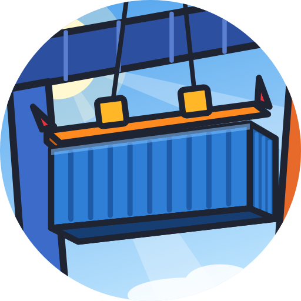

<p align="center"></p>

<h1 align="center">Crane Bay</h1>

Jeu mobile Android de gestion de terminal à conteneurs, vu de dessus. Développé avec Unity (C#).
Gratuit, sans publicité ni achat intégré, distribué en APK hors store.

> **État : prototype jouable (v0.1).** La boucle complète est en place (navire → parc → camion/train →
> argent → amélioration), avec les coffres, la sauvegarde et les contrôles tactiles. Les graphismes sont
> des formes dessinées par code (aucun asset externe) : ils servent de base lisible en attendant de vrais
> sprites.

## Le jeu en bref

1. Un **porte-conteneurs** arrive à quai (en haut de l'écran) avec 6 à 12 conteneurs.
2. Le joueur commande le **portique** pour déposer chaque conteneur dans le **parc** (5 × 4 emplacements,
   3 conteneurs par pile au départ, 4 avec l'agrandissement).
3. **Camions** (2 places sur la route) et **trains** (3 wagons) arrivent et demandent une couleur précise,
   affichée en silhouette sur la remorque ou le wagon, avec sa valeur.
4. Chaque conteneur livré rapporte de l'argent : blanc 10 $, bleu 25 $, vert 50 $, rouge 100 $, doré 250 $
   (+50 % en train).
5. L'argent achète des améliorations au coût croissant : **vitesse de la grue**, **attente entre deux
   navires**, **attente entre deux camions/trains** (10 niveaux chacune), **agrandir le parc** (2 niveaux :
   une 4e rangée, puis des piles de 4), une **2e grue** (elle dessert le parc, les camions et les trains,
   mais pas le navire) et **revenus** (10 niveaux, +10 % d'argent par niveau sur les livraisons et les
   primes de contrats).

**Le casse-tête :** la grue ne peut saisir que le conteneur du dessus d'une pile. Pour sortir un conteneur
enfoui, il faut d'abord déplacer ceux qui sont au-dessus. Un véhicule qui attend trop longtemps (jauge de
patience) repart à vide.

**Niveaux :** chaque conteneur livré rapporte des XP (1 à 12 selon la couleur, +50 % en train). Quand la
barre d'XP est pleine, on passe au niveau suivant (30 niveaux, +30 % d'XP requis à chaque niveau) :
- le niveau n'est validé qu'une fois **tous les camions et trains présents servis** (ou partis) : la barre
  affiche « Niveau prêt ! » et aucun nouveau véhicule n'arrive en attendant ;
- prime en argent (50 $ × le nouveau niveau) ;
- **les améliorations coûtent plus cher** : +12 % par niveau de joueur (composé), en plus de la hausse
  propre à chaque niveau d'amélioration ;
- **le terminal se réinitialise** : parc et navire vidés, véhicules renvoyés, un nouveau navire arrive.
  L'argent, les améliorations et les coffres sont conservés ;
- de nouvelles couleurs apparaissent : vert au niveau 2, rouge au niveau 4, doré au niveau 6. Au niveau 1,
  il n'y a que du blanc et du bleu ;
- les navires arrivent plus chargés : +1 conteneur tous les 3 niveaux.

Les règles sont dans `Core/LevelRules.cs`.

**Fin de niveau :**
- *Étoiles* : la bannière fait le bilan du niveau, de 1 à 3 étoiles. On a 1 étoile d'office, +1 si au plus un
  véhicule est reparti sans être servi, et +1 si au moins un quart des livraisons ont eu le bonus rapidité.
  La prime de niveau est multipliée par 1, 1,5 ou 2, et 3 étoiles offrent un turbo de grue de 2 min.
- *Carte au choix* : ensuite, le joueur choisit une récompense parmi trois cartes : de l'argent
  (100 $ × niveau), un turbo de 3 min, ou un niveau gratuit sur l'amélioration la moins chère.

**Série de jours :** le coffre du jour suit une série de 7 jours (« Jour 3/7 » sur le bouton). Chaque jour
d'affilée ajoute +25 % d'argent, jusqu'à x2,5 au 7e jour, qui offre aussi un long turbo. Une absence de plus
de 48 h depuis la dernière ouverture remet la série au jour 1.

**Feu d'artifice :** chaque passage de niveau déclenche un feu d'artifice (fusées, gerbes d'étincelles,
sifflements et détonations), une fanfare et une bannière qui annonce la prime et les nouveautés.

**Conteneurs spéciaux :**
- *20 pieds* (dès le niveau 2) : deux fois plus courts, ils valent 60 % d'un 40 pieds. Un 40 pieds ne peut
  pas être posé sur un 20 pieds.
- *Frigorifiques* (dès le niveau 3, symbole bleu) : +50 % de valeur, mais ils doivent être branchés sur la
  rangée électrifiée du parc (la plus proche du quai, prises jaunes). Débranchés, ils perdent de la valeur
  en 90 s (jusqu'à 30 %).
- *Dangereux* (dès le niveau 5, losange orange) : +40 % de valeur, mais jamais deux dans la même pile ni dans
  deux piles voisines.

**Autres mécaniques :**
- *Véhicule annoncé* : dès qu'un camion ou un train apparaît, son emplacement d'arrêt clignote au quai
  avec les couleurs demandées. On peut déjà le viser : la grue prend le conteneur, se place au-dessus
  et dépose dès que le véhicule est à quai (l'ordre n'est plus perdu).
- *Commandes à venir* : le bandeau « À venir » montre les 3 prochains véhicules et leurs couleurs.
- *Bonus rapidité* : +20 % si le conteneur est livré dans les 10 s après l'arrivée du véhicule.
- *Contrats du jour* : 3 objectifs renouvelés chaque jour (ex. « livrer 5 rouges en train »), avec prime
  en argent et en XP.
- *Météo et jour/nuit* : un cycle jour/nuit de 10 min (lampadaires la nuit). Le vent ralentit la grue de
  15 %, la pluie de 5 %.
- *Ports à thème* : port tempéré, puis tropical au niveau 10 et polaire au niveau 20 (eau, quai, végétation).
- *Statistiques et records* : bouton « Contrats & records » (livraisons, navires, trains, meilleur train,
  déchargement le plus rapide, meilleure livraison).

**Coffres :**
- *Coffre du jour* : toutes les 24 h, de l'argent et parfois un turbo de grue (x2 pendant 5 min).
- *Coffre 20 min* : de l'argent ou un turbo de 2 min. Il se recharge aussi quand le jeu est fermé.
- Le jeu enregistre l'heure UTC de la dernière ouverture, pas un compte à rebours : le timer reste exact
  après une fermeture ou un redémarrage du téléphone.

**Musique :** une boucle d'ambiance tropicale (ukulélé, steel drum, basse, shaker) est
générée par code au lancement (`Core/MusicSynth.cs`) : pas de fichier audio, donc aucun problème de droits.
Le bouton « Son » fait défiler : sons + musique, sons seuls, muet.

**Pause :** le bouton ⏸ à gauche du bandeau « À venir » (ou le bouton retour d'Android) fige le jeu :
grues, véhicules, attente du navire et patience des chauffeurs. Les coffres continuent de se recharger.
L'écran de pause propose « Reprendre » et « Sauvegarder et quitter ».

**Contrôles :** toucher une pile puis toucher la destination, ou glisser-déposer du doigt. Les destinations
possibles s'allument en vert. Le bouton retour d'Android annule la sélection, sinon met le jeu en pause.

**Orientation : portrait**, pour jouer à une main. Pour passer en paysage, il faut modifier
`ProjectSetup.cs` (orientation) et `BoardLayout.cs` (disposition).

## Prérequis

- **Unity 6 LTS** (série 6000.x), installé avec Unity Hub.
- Module **Android Build Support**, avec **OpenJDK** et **Android SDK & NDK Tools** cochés. On l'ajoute
  dans Unity Hub > Installs > ⚙ > Add modules.

Le projet n'ajoute aucun package en dehors de uGUI et des modules standard (voir `Packages/manifest.json`).

## Ouvrir le projet

1. Cloner le dépôt.
2. Dans Unity Hub, cliquer sur **Add > Add project from disk** et choisir le dossier du dépôt.
   Le dossier `ProjectSettings/` contient `ProjectVersion.txt` (Unity 6000.0.85f2) : c'est lui qui permet
   au Hub de reconnaître le projet. Avec une autre version de Unity 6, le Hub propose de le convertir.
3. Au premier chargement, Unity génère `Library/` et complète `ProjectSettings/`, puis le script
   `ProjectSetup` configure tout seul le projet :
   - il crée la scène `Assets/Scenes/Main.unity` et l'ajoute au build ;
   - il règle Android : portrait, paquet `com.cranebay.prototype`, IL2CPP + ARM64, Gamma, APK (pas AAB).

   Ces réglages peuvent être relancés à tout moment par le menu **Crane Bay > Configurer le projet**.
4. Dans l'onglet **Game**, choisir une résolution portrait (par exemple 1080 × 1920), puis lancer **Play**.
   Dans l'éditeur, la souris remplace le doigt.

## Générer un APK de test

### Depuis l'éditeur

Menu **Crane Bay > Construire l'APK de test**.
Le script passe la plateforme sur Android si besoin (la première fois, cela peut prendre quelques minutes),
puis produit **`Builds/Android/CraneBay.apk`**, signé avec la clé de debug de Unity.

La variante *(mode développement)* ajoute le profiler et les logs (`adb logcat -s Unity`).

### En ligne de commande

```bash
# Windows : "C:\Program Files\Unity\Hub\Editor\<version>\Editor\Unity.exe"
# macOS   : /Applications/Unity/Hub/Editor/<version>/Unity.app/Contents/MacOS/Unity
Unity -batchmode -quit -projectPath /chemin/vers/crane-bay -buildTarget Android \
      -executeMethod CraneBay.EditorTools.BuildScript.BuildAndroidApk -logFile build.log
```

Le code de sortie vaut 0 si le build réussit, 1 sinon (le détail est dans `build.log`).

Ajouter `-appVersion 0.1.2` pour fixer la version de l'application (et un *versionCode* croissant,
ici 102, pour qu'Android installe l'APK comme une mise à jour).

### Sous Windows, en une commande

`Tools/build-apk.ps1` met le dépôt à jour depuis `main`, lance Unity en mode batch (sans ouvrir l'éditeur)
et copie le résultat en `Builds/Android/CraneBay_v<version>.apk` :

```powershell
E:\CraneBay-git\Tools\build-apk.ps1 -Version 0.1.2            # APK seulement
E:\CraneBay-git\Tools\build-apk.ps1 -Version 0.1.2 -Release   # + préversion GitHub (gh auth login requis)
E:\CraneBay-git\Tools\build-apk.ps1 -Version 0.1.6 -Release -Title "Bonus et séries" -NotesFile notes.md
```

Le dossier utilisé par le script ne doit pas être ouvert dans l'éditeur Unity pendant le build :
utiliser un clone dédié, distinct du dossier de travail.

### Installer sur le téléphone

- **Par câble :** activer le *débogage USB* (Options pour les développeurs), puis
  `adb install -r Builds/Android/CraneBay.apk`.
- **Sans câble :** copier l'APK sur le téléphone, l'ouvrir depuis le gestionnaire de fichiers et autoriser
  « Installer des applications inconnues » pour cette application.

Pour une vraie diffusion hors store, remplacer la clé de debug par un keystore personnel
(Player Settings > Publishing Settings) et le conserver précieusement : toutes les mises à jour devront
être signées avec la même clé.

## Organisation du code

Tous les scripts sont commentés en français.

```
Assets/CraneBay/Scripts/
├── Core/            Logique pure, SANS dépendance Unity (testable hors moteur)
│   ├── GameRules.cs     Équilibrage : valeurs, améliorations, timers, tailles du parc
│   ├── StackGrid.cs     Piles de conteneurs : on ne prend que le dessus, hauteur max
│   ├── PortModel.cs     Règles du terminal : navires, véhicules, demandes, paiement, coffres
│   ├── LevelRules.cs    Niveaux : XP, seuils, primes, déblocages, thèmes, tirage des conteneurs
│   ├── Contracts.cs     Contrats du jour
│   ├── MusicSynth.cs    Musique d'ambiance synthétisée (4 styles, tropical par défaut)
│   ├── Ambience.cs      Cycle jour/nuit et météo (déterministes, basés sur l'heure)
│   ├── ChestLogic.cs    Timers de coffres basés sur l'horloge UTC, récompenses
│   ├── SaveData.cs      Données sauvegardées + réparation des sauvegardes anciennes
│   └── ContainerTypes.cs
├── Game/            Couche Unity (affichage, entrées, sons)
│   ├── GameManager.cs   Chef d'orchestre : relie le modèle aux vues, sauvegarde auto
│   ├── CraneController.cs  Portique : déplacements fluides, file d'ordres, levage
│   ├── InputController.cs  Tap-tap et glisser-déposer
│   ├── Hud.cs           Interface uGUI construite par code (safe area gérée)
│   ├── ShipView.cs, VehicleView.cs, ContainerView.cs, WorldBuilder.cs
│   ├── AmbienceView.cs  Voile de nuit, halos des lampadaires, vent, pluie
│   ├── Fireworks.cs     Feu d'artifice du passage de niveau (sprites recyclés)
│   ├── SpriteFactory.cs Sprites générés dans un atlas unique (contours nets, ombres douces)
│   ├── AudioManager.cs  Bruitages synthétisés (pas de fichiers audio)
│   ├── SaveSystem.cs    JSON local, écriture atomique
│   └── Bootstrap.cs     Lance le jeu même depuis une scène vide
└── Editor/
    ├── ProjectSetup.cs  Scène + réglages Android + menus de test
    └── BuildScript.cs   Génération de l'APK (menu et ligne de commande)
Tests/CoreTests/     Tests .NET de la logique (sans Unity)
```

Toute la scène est construite par code au lancement. C'est voulu : il n'y a ni prefab ni scène à
maintenir à la main, et le projet s'ouvre proprement quelle que soit la version de Unity 6.

### Équilibrage

Tous les chiffres sont dans `Core/GameRules.cs` : valeur et rareté des couleurs, coût de base et
croissance des améliorations, attentes entre navires et véhicules, durée des coffres. La patience des
véhicules se règle dans `PortModel.cs` (`TruckPatience`, `TrainPatience`).

### Sauvegarde

Le fichier `cranebay_save.json` est écrit dans `Application.persistentDataPath`. Sur Android, c'est
`Android/data/com.cranebay.prototype/files/`. Il contient l'argent, le niveau et les XP, les niveaux d'amélioration, le parc,
le navire à quai, les horodatages des coffres et du prochain navire. La sauvegarde a lieu toutes les
10 s, après chaque achat ou coffre, et quand l'application passe en arrière-plan.

Les camions et trains en attente ne sont pas sauvegardés : de nouveaux arrivent au lancement suivant.
Les conteneurs déjà livrés ont été payés, donc rien n'est perdu.

Menus utiles dans l'éditeur : **Crane Bay > Test : effacer la sauvegarde**, **+1 000 $**,
**recharger les coffres**, **ouvrir le dossier de sauvegarde**.

### Performances (Android d'entrée de gamme)

- 60 FPS visés (`targetFrameRate = 60`), pas de physique, pas de lumière, pipeline intégré (Built-in).
- Tous les sprites viennent d'une seule texture 256 × 256, ce qui permet de les regrouper en peu de draw calls.
- Espace colorimétrique Gamma, aucune allocation par image dans la boucle principale (textes et indicateurs
  réutilisés).

## Tests

La logique du jeu (règles d'empilage, timers des coffres hors ligne, coûts des améliorations, réparation de
sauvegarde, et **une partie complète simulée** : navire → parc → livraison → achat d'amélioration) est testée
sans Unity :

```bash
dotnet run --project Tests/CoreTests
```

Ces tests tournent aussi automatiquement sur GitHub (Actions) à chaque push.

## Limites connues du prototype

- Graphismes et sons procéduraux (placeholders lisibles), à remplacer par de vrais assets.
- Un seul poste à quai. Un 20 pieds occupe une place entière du parc (pas deux 20 pieds côte à côte sur un
  emplacement de 40) : règle simplifiée.
- Rien n'a encore été testé dans Unity : la logique est couverte par les tests .NET et le code Unity
  compile contre les DLL de référence, mais l'équilibrage et le rendu restent à vérifier en jeu.
- Pas de menu titre ni de réglages en dehors du bouton son.
